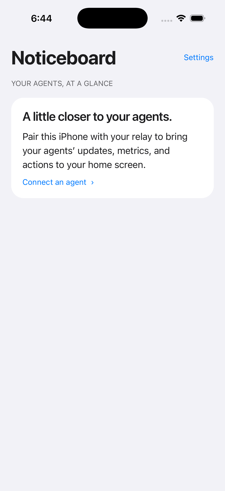
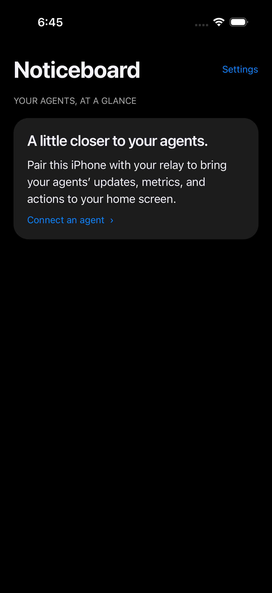

# Agent Noticeboard

**Updates and actions from any AI agent.**

An iPhone home for **any agent**. Send a note, a metric, a chart, or a decision to your phone using a small JSON API. Get button taps back through a signed webhook or polling. Bring your own agent, model, scheduler, or scripts: no AI provider account or SDK is required by this app.

- Native iOS navigation, system typography, grouped cards, and automatic light/dark appearance.
- Server-driven dashboard: text, Markdown, metrics, lists, images, and actions.
- Reminder pages: an agent publishes Markdown with `POST /pages`, and `POST /notify` can include `pageId` so a tap opens that page.
- SwiftUI widgets for notes, metrics, charts, and interactive buttons; Lock Screen and StandBy layouts. Up to 100 named items, with independent Content selection on each placed widget.
- Widget taps open snapshot details; named button grids report their widget ID to your agent.
- Send feedback beneath a report with its original context and configured agent recipient.
- Push notifications, Live Activities, Siri, Shortcuts, and Action Button support.
- Expo/TypeScript app, Cloudflare Worker + D1 relay, shared validated schemas.
- Linux-operated EAS Build, Submit, and fingerprint-aware OTA updates. No local Mac needed.

**This is a self-hosted template, not a hosted service.** You need your own Apple Developer membership, Expo project and Cloudflare account. The current native features require iOS 26+. Cloud build/service fees may apply. Physical push and widget behavior must be verified on your own device.

  
  

## Start with your agent

Use this repository as a template, then give your agent:

> Read AGENTS.md and docs/SETUP.md. Configure this copy for my accounts, preserve secret boundaries, deploy my relay, and build my private TestFlight app. Use docs/OPERATIONS.md for the API contract. Ask me for missing identifiers and authentication steps; never use the template author's infrastructure.

1. [Set up your installation](docs/SETUP.md)
2. [Connect any agent](docs/INTEGRATION.md)
3. [Operate and ship updates](docs/OPERATIONS.md)

`app/` contains the app and native SwiftUI surfaces; `relay/` contains the API, migrations and smoke script; `shared/schema.ts` is the source of truth for data shapes. `scripts/configure.mjs` installs your non-secret identifiers consistently across native and hosted code.

Deployments are disabled until you explicitly set `DEPLOY_ENABLED=true` in your GitHub repository variables. Never add private keys, pairing codes, device tokens, or personal dashboard content to this public project.

## Contribute

Use Node 24 and `npm ci`. Run `npm run typecheck`, `npm run lint --workspace app`, and `npm test`. Native changes require hosted native verification and a new binary. Open a pull request with the behavior change and validation evidence. See [CONTRIBUTING.md](CONTRIBUTING.md).

MIT licensed. Apple, Expo, and Cloudflare services retain their own terms. This project is not affiliated with Apple or any AI provider.
